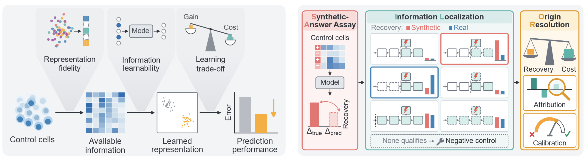

# scSAILOR

[](https://github.com/yuyangzhang-young/scSAILOR/actions/workflows/tests.yml)

**Which information from control cells does a perturbation-response model read, and does reading it help the model predict?**



Models that predict how cells respond to a perturbation usually take a set of control cells as input. scSAILOR asks which statistics of that set a trained model uses, and whether using them helps it predict. An *information ladder* gives the model inputs that keep progressively more of the control cells' statistics. Three components then follow the information from input to prediction:

- the **synthetic-answer assay** plants known states into measured control cells and measures how much of each a trained model recovers;
- **information localization** finds where inside the model learning of a missed state is obstructed, and which change restores it;
- **origin resolution** asks what that change costs on held-out data, attributes the remaining error to the model, the data or the task set-up, and recommends what to keep of a prediction.

## Installation

Python 3.11 or later. To install the package with PyTorch:

```bash
pip install "scsailor[torch] @ git+https://github.com/yuyangzhang-young/scSAILOR"
```

The information ladder, the assay's data handling and the scores need only NumPy, h5py and SciPy; PyTorch is needed to build and train models. To work on the code, clone the repository, install it in editable mode with the test extra, and run the tests:

```bash
pip install -e ".[torch,test]"
```

```bash
pytest
```

## Quick start

[`examples/quickstart.py`](examples/quickstart.py) runs the synthetic-answer assay, information localization and origin resolution on a small screen and a small network in a few minutes on a CPU. Random arrays stand in for the data, so it runs as it is; [`examples/README.md`](examples/README.md) says what to replace with your own data, what the package calls on your model, and how a full run differs.

```bash
python examples/quickstart.py --out quickstart-run
```

The input files a dataset must provide are described in [`docs/data_contract.md`](docs/data_contract.md).

## Repository

| Path | Contents |
|---|---|
| `src/scsailor/carrier.py` | The information ladder: input sets that keep exactly one level of the control cells' statistics |
| `src/scsailor/models/` | The three models built for the study: attention, DeepSets, summary statistics |
| `src/scsailor/natural/` | Training on measured responses, and held-out scores |
| `src/scsailor/assay/` | The synthetic-answer assay |
| `src/scsailor/localization/` | Information localization |
| `src/scsailor/resolution/` | Origin resolution |
| `examples/` | The quick start |
| `docs/` | [The components and their modules](docs/components.md); [the data contract](docs/data_contract.md) |
| `tests/` | Tests that need no study data |
| `reproduce/` | The paper's results tables, rebuilt from the deposited data (below), and the runs of the published models |
| `requirements/` | The package versions with which the tables were computed and the models trained |
| `third_party/` | Upstream code of State, CPA and PrePR-CT, used only by `reproduce/published_models/` |

[`docs/components.md`](docs/components.md) describes each component step by step, with the module behind each step and short examples of the ladder and the built models.

## Reproducing the paper

The data are downloaded from Zenodo, checked against the MD5 checksums Zenodo publishes and the SHA-256 checksums of [`reproduce/data/MANIFEST.tsv`](reproduce/data/MANIFEST.tsv), and unpacked under one data root (`zstd` and `tar` must be installed):

```bash
python -m reproduce.fetch --root DATA
```

`--records` downloads only some of the five records (below); `--archives` only the archives whose names start with the given names, for example `--records inputs --archives replogle-nadig-jiang-one-case` for the one case of origin resolution. Archives already downloaded by hand, for example from the share link of a record not yet published, are unpacked and checked without downloading anything: save them in one folder and add `--local FOLDER` to the same command. The manifest lists every deposited file with its size, checksum, archive, record and licence.

Every results table of the paper is rebuilt from the deposited data by one command per part of the paper. Each command reads the data root given by `--data` ([`reproduce/data/FOLDERS.tsv`](reproduce/data/FOLDERS.tsv) lists its folders), writes its tables under `--out`, and with `--compare ROOT` prints `equal`, `DIFFERS` or `not deposited` for every table against the deposited one at the same path, cell for cell. On another CPU the last digits of a value can differ; a `DIFFERS` is then checked numerically.

| Part of the paper | Command | Rebuilt from | Time on a CPU |
|---|---|---|---|
| Results 1-2: the information ladder (Figs. 1-2, Supplementary Fig. 1, Supplementary Data 1-2) | `python -m reproduce.ladder.tables` | the saved per-fit scores and the fold data | under a minute |
| Results 3: the synthetic-answer assay (Fig. 3) | `python -m reproduce.assay.tables` | the saved per-fit synthetic scores and the instances | about 25 minutes |
| Results 4: information localization on Tahoe-100M (Fig. 4) | `python -m reproduce.information_localization.tables` | the saved run records | minutes |
| Results 5-6: origin resolution (Figs. 5 and 6a,b, Supplementary Data 3) | `python -m reproduce.origin_resolution.results --row all` | the saved predictions | about 11 hours |
| Results 7: memorization and readers (Fig. 6c-g) | `python -m reproduce.memorization.tables` | the saved predictions | about 25 minutes |

One case of origin resolution runs in minutes on a laptop from a subset of the data under 1 GB: `python -m reproduce.origin_resolution.one_case`. Each folder's README gives its tables, the printed results they hold, its inputs and what it does not include.

The tables were computed with the versions in `requirements/analysis.txt`:

```bash
pip install -e ".[test]" -r requirements/analysis.txt
```

Training and forward passes use `requirements/models.txt`. The built models are trained with the package (`scsailor.models`, `scsailor.assay.train`, `scsailor.natural`) under the settings of `reproduce/assay/study.py` and `reproduce/information_localization/`; the published models with `reproduce/published_models/`; the retraining runs of Results 7 with `reproduce/memorization/retraining.py` and `published_retraining.py`. Training on a GPU does not repeat bit for bit.

## Data

The raw datasets are not redistributed. Their sources:

| Dataset | Source | Licence |
|---|---|---|
| Tahoe-100M | Hugging Face `tahoebio/Tahoe-100M`; Zhang et al., Cell 2026, doi:10.1016/j.cell.2026.08.035 | CC0 1.0 |
| GSE306429 | GEO GSE306429; DeMeo et al., Science 2025, doi:10.1126/science.adi8577 | GEO terms |
| Parse PBMC | Parse Biosciences, "10 million human PBMCs in a single experiment"; Oesinghaus et al., bioRxiv 2025, doi:10.64898/2025.12.12.693897 | CC BY-NC 4.0 |
| Replogle–Nadig | figshare+ doi:10.25452/figshare.plus.20029387.v1 (K562, RPE1; Replogle et al., Cell 2022, doi:10.1016/j.cell.2022.05.013); GEO GSE264667 (HepG2, Jurkat; Nadig et al., Nat Genet 2025, doi:10.1038/s41588-025-02169-3) | CC BY 4.0; GEO terms |
| Jiang et al. | Zenodo doi:10.5281/zenodo.14035992 (v2.0); Jiang et al., Nat Cell Biol 2025, doi:10.1038/s41556-025-01622-z | CC BY 4.0 |

What the study derived from them is deposited on Zenodo in five records:

| Record | Contents | DOI |
|---|---|---|
| `tables` | Every table the commands above write | [10.5281/zenodo.23997774](https://doi.org/10.5281/zenodo.23997774) |
| `inputs` | The inputs drawn from each dataset's control cells, the measured targets, the synthetic-answer instances, the saved per-fit scores and the run records | [10.5281/zenodo.24210211](https://doi.org/10.5281/zenodo.24210211) |
| `other-screens` | The models' saved predictions on GSE306429, Parse PBMC and the genetic screens | [10.5281/zenodo.24212188](https://doi.org/10.5281/zenodo.24212188) |
| `tahoe-100m-control-use-and-probes` | The models' saved predictions on Tahoe-100M: control use and fixed-weight probes | [10.5281/zenodo.24212190](https://doi.org/10.5281/zenodo.24212190) |
| `tahoe-100m-repairs` | The models' saved predictions on Tahoe-100M: the restoring changes | [10.5281/zenodo.24212192](https://doi.org/10.5281/zenodo.24212192) |

[`reproduce/data/FOLDERS.tsv`](reproduce/data/FOLDERS.tsv) lists the data root's folders. Each file is under the licence its sources allow: CC BY 4.0, and CC BY-NC 4.0 for everything derived from Parse PBMC. State's predictions are outputs of the State model; their records cite Adduri et al., Cell 2026, doi:10.1016/j.cell.2026.07.052, as its licence asks. The gene sets are MSigDB Hallmark 2025.1.Hs (Liberzon et al., Cell Systems 2015, doi:10.1016/j.cels.2015.12.004; CC BY 4.0), and the gene symbols are from HGNC (CC0).

## Third-party code

The published models of the paper (State, CPA and PrePR-CT) were adapted from their authors' code. `third_party/` holds the upstream files this needs, unchanged and pinned to the versions used: State repository commit `9bbfe78` (which also contains the CPA implementation used) and PrePR-CT release `v1.0.0`. Each directory carries its upstream licence and a `NOTICE.md` with the origin and the changes made: none for State, two one-line changes for CPA (`patches/cpa.patch`) and one removed seed statement for PrePR-CT (`patches/prepr_ct.patch`), each applied at run time to a copy. Only `reproduce/published_models/` loads these files; nothing under `src/` imports them. How to run the published models is described in [`reproduce/published_models/README.md`](reproduce/published_models/README.md).

## Licence

The code written for scSAILOR (`src/`, `examples/`, `tests/`, `docs/`, `reproduce/`) is released under the [Apache License 2.0](LICENSE). The files under `third_party/` are **not** covered by it: they keep their upstream licences, which include the non-commercial terms of State's licences (CC BY-NC-SA 4.0 and the Arc Research Institute State Model Non-Commercial License) and GPL v3.0 for PrePR-CT. See [`third_party/README.md`](third_party/README.md).

## Citation

[Paper reference to be added.]
