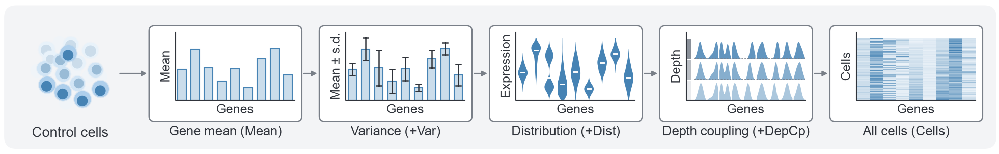

# The components of scSAILOR

This page describes the information ladder, the three built models and the three components, and names the module behind each step. The paper's terms for the short names used in code are listed in each package's `__init__.py`.

## The information ladder



From the control cells of one context (log-normalized expression and sequencing depth), `scsailor.carrier.make` builds the 512 rows a model receives. Each level keeps exactly the statistics named below and nothing more:

| Level (code key) | The rows keep |
|---|---|
| Mean (`L1`) | each gene's mean |
| +Var (`L2`) | each gene's mean and sample variance |
| +Dist (`L3`) | each gene's marginal distribution |
| +DepCp (`L3d`) | each gene's marginal distribution within sequencing-depth strata |
| Cells (`L4`) | the cells themselves |

```python
import numpy as np
from scsailor.carrier import make, check_carriers

rng = np.random.default_rng(0)
cells = np.log1p(rng.gamma(0.5, 4.0, size=(256, 2000)))   # 256 control cells x 2,000 genes
depth = np.sort(rng.integers(1_000, 20_000, size=256))     # sequencing depth of each cell

rows, row_depth = make(cells, depth, "L2", rng)            # 512 x 2,000 rows at +Var
check_carriers(cells, depth)                               # verifies the moments and multisets
```

## Built models

The study's three models share one form: the prediction is an anchor (the control mean plus the transferred response, the perturbation's mean offset) plus a correction computed by the model from the rows, their sequencing depths and a learned perturbation embedding.

| Model | Code key | How it combines cells |
|---|---|---|
| Attention model | `attention_model` | Self-attention across the cells (8 blocks, width 768, 12 heads, after State's published sizes; it is not the published State model) |
| DeepSets model | `deepsets` | Encodes each cell, then averages |
| Summary-statistics model | `summary` | Reads means, variances, sorted marginals, depth-stratified marginals and a learned pairwise term, each from its first level on |

```python
import torch
from scsailor.models import RawModel, set_runtime

set_runtime(31002)                                         # seeds and full-precision matrix products
model = RawModel("deepsets", intercept=np.zeros(2000, np.float32), p_count=4,
                 r_input=np.zeros((4, 2000), np.float32), c_train=cells.mean(0).astype(np.float32))
with torch.no_grad():
    profile = model(torch.from_numpy(rows)[None], torch.from_numpy(row_depth)[None],
                    torch.tensor([2]), "L2")               # 1 x 2,000 predicted profile
```

Held-out predictions are scored by `scsailor.natural.score.risk`, which splits the mean squared error into a common error (shared by all perturbations of a context) and a contrast error (the rest).

## The synthetic-answer assay

The assay plants 25 known states into measured control cells. Each planted state changes one cue (shift, spread, skew, depth trend or covariation) of two genes, and a response field calibrated on measured responses turns the states into a synthetic target. A model trained on these inputs at one level of the ladder is then scored on how much of each planted state's effect it recovers (recovery Q = 1 − M/E).

`scsailor.assay` holds one module per step: `generator` (the synthetic target), `carrier` (the model input), `stream` and `train` (training), `replay` (predictions on the evaluation support), `score` (recovery), `probe` (linear readers on internal features) and `capability` (the table of what each model reads). An instance is a directory of five files, described in [`docs/data_contract.md`](data_contract.md). [`tests/assay/test_tiny_instance.py`](../tests/assay/test_tiny_instance.py) builds a tiny instance from random arrays and runs it end to end.

Code and saved files keep short names; the paper's terms are listed in [`src/scsailor/assay/__init__.py`](../src/scsailor/assay/__init__.py) (for example, a *bit* is a planted state and the *known answer* is the synthetic target).

## Information localization

When a trained model misses a planted state, information localization asks where inside the model learning it is obstructed. A cut divides the network into a front and the part behind it, and the part behind the cut is trained on the synthetic targets from several starting points: fine-tuning, a reset of the part behind the cut, of the front or of the perturbation embedding, and training from scratch. Which starting point learns the state says where learning is obstructed. Planted faults with a known site set the reading rules. The change that restores the state is then applied unchanged to the model trained on measured responses.

`scsailor.localization` holds one module per step: `starts` (one starting point at one cut, with exact resume), `readings` (the reading rules over finished runs), `presence` (how strongly a planted state still moves each cut, without training), `training_time` (recovery along the model's own saved checkpoints) and `real_task` (the restoring change on measured responses). `task.Task` reads an assay instance as these steps draw from it, and `contract` gives the cuts of the three built models. The study's settings, such as seeds, panels and planted faults, are passed in as arguments. `scsailor.localization.light` is the light version: fixed menus of cuts, starting points and learning rates for each model and fixed seeds, one for the parts and a second for the best candidates, with the recovery level, margins and choice of `readings` read on the validation panel; it writes the run lists and reads the finished runs. The paper's terms are listed in [`src/scsailor/localization/__init__.py`](../src/scsailor/localization/__init__.py).

## Origin resolution

A model's prediction is its anchor (the control mean plus the transferred response) plus its correction. Origin resolution follows each restoring change from information localization through four steps, and asks what it costs on held-out lines, why, and whether any of it pays:

1. **Recovery and cost** trains the change on measured responses and sets it beside its original model, continued training and training longer.
2. **Attribution** says where the error sits and which origin it points to: the model, the data or the task set-up.
3. **Calibration** recommends what to keep of a prediction, or refuses, on lines that no model of the nested chain has seen.
4. **The held-out check** reports the same differences on held-out lines, which take no part in any choice.

`scsailor.resolution` follows these steps: `il_cells` for recovery and cost; `attribution`, `origins`, `references` and `probes` for attribution; `slopes`, `policies`, `card`, `menu` and `net_cost` for calibration, with `planted` for its known-answer test on planted changes; and `comparison` for the held-out check. `stages` runs them over one dataset's case, whose contract it states. A dataset's facts, such as the names of its replicate plates, are passed in as arguments. The paper's terms are listed in [`src/scsailor/resolution/__init__.py`](../src/scsailor/resolution/__init__.py).
